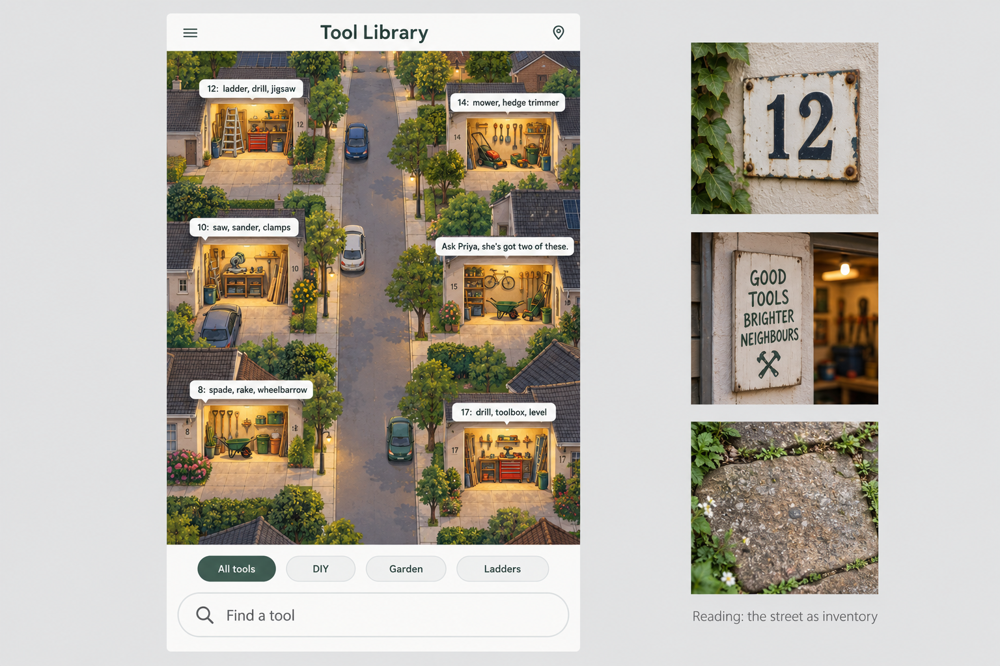
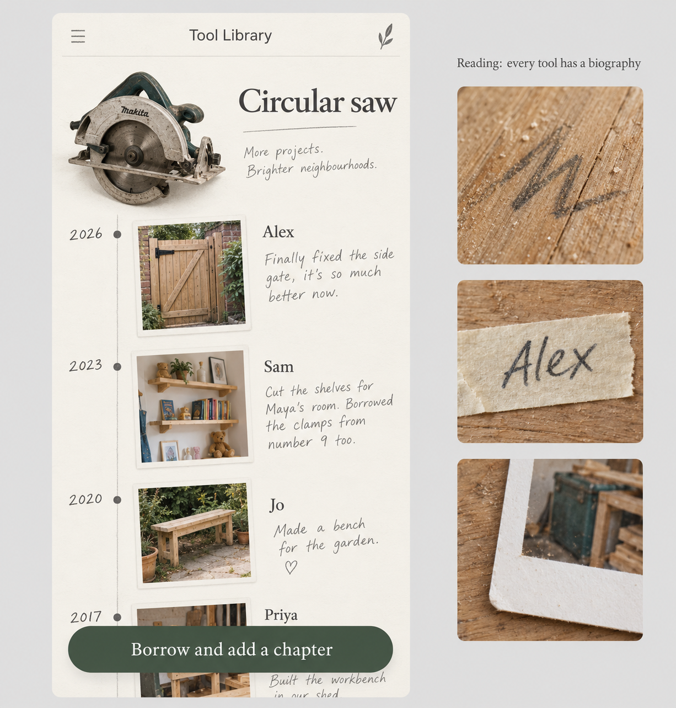
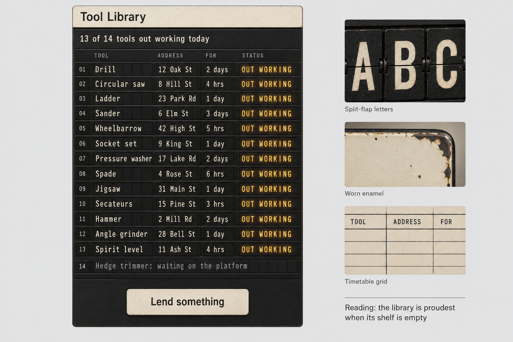

# interface-craft

A design workflow plugin for [Claude Code](https://claude.com/claude-code). You know what your project is for. interface-craft's job is to turn that knowledge into a design direction you've corrected before anything expensive gets built, then build it properly and have it checked by reviewers who didn't build it.

Left to themselves, models design the average of everything they've seen: Inter, a soft gradient, a hero and three feature cards. The cure isn't a better style guide; it's better material. So most of this plugin is about getting the specific, slightly odd, true things about your project out of your head and into the design, and keeping the model from settling on its first idea.

## What a new project looks like

Say "help me design a site for my tool library" and this happens:

1. Claude interviews you about the project, not the design. That's three rounds of 3 to 7 questions, and none of them are about colours or fonts. You get asked about the last person who borrowed something, what nearly stopped them, what the street would lose if the library shut. Round one collects stories, and round two pushes on your own words and the tensions in them. If you open with nothing but "help me design a website", it starts by asking you to describe the project in your own words.
2. Between rounds, Claude grows several readings of your project, called seeds, in a scratchpad you can read but aren't asked to judge. They're spread from obvious/fitting to wild/extreme, and a separate judge agent with no stake in them picks three to develop.
3. Round three opens with three reading boards: images generated in parallel through OpenAI's image model via the Codex CLI. They're probes, not proposals. You react, steal parts from each, and say what's missing.
4. Claude merges what you kept into one direction, writes its full spec into `DESIGN-BRIEF.md`, and shows one image of it. Then you choose: build, ask more, or see new readings.

Here are three readings of that tool library brief, as round three shows them:

| The street as inventory | Every tool has a biography | The library is proudest when its shelf is empty |
| --- | --- | --- |
|  |  |  |

After that, the usual design work takes over:

- `explore` compares options full size, built by blind agents so they don't converge politely.
- `build` works from the direction spec, with every state handled.
- `verify` screenshots the result and sends it to three reviewers in parallel: lint, correctness and craft. Blocking findings hold Claude's turn open until they're fixed or you dismiss them.
- `feedback` records your explicit reactions. Repeated ones become project rules, and repeats across projects become proposals for your taste profile, which need your yes.

## Install

In Claude Code:

```bash
claude plugin marketplace add Barncore/interface-craft
claude plugin install interface-craft@interface-craft
```

Then run the setup check and, for the round-three images, set up Codex. [docs/setup.md](docs/setup.md) walks through both, including the Claude desktop app.

## What you need

| Need | Required? | Notes |
| --- | --- | --- |
| Claude Code | yes | Terminal, desktop app or IDE extension |
| Node.js 18 or later | yes | The hooks and scripts are plain Node with no dependencies |
| Codex CLI signed in with a ChatGPT account | for images | Without it, the interview still runs and round three happens in words |
| Windows x64 | for the bundled detector and live editing | Elsewhere, reviews use the model's own pattern checks instead |

## What's inside

| Part | What it does |
| --- | --- |
| `route` | Entry point. Reads your project's design files and hands off to the right skill. |
| `intent-interview` | The three-round interview, seeds, reading boards and the direction. |
| `explore` | Concept directions and one-axis variants, compared full size. |
| `build` | Implementation, with references for type, colour, motion, gesture, copy and native platforms. |
| `verify` | Screenshots plus three blind reviewer agents, with separate pattern checks for websites and native apps, and worst-case data for anything that shows user data. |
| `feedback` | An append-only record of your reactions, and taste proposals from repeats. |
| `deslop` | Strips generated cruft without touching what does work. |
| `live-edit` | Point at an element in your running local site and try variants in place (Windows). |
| `animation-vocabulary` | "What's that effect called?" |
| `agents/` | The lint, correctness and craft reviewers, and the seed judge. |
| `hooks/` | A routing reminder each prompt, an advisory detector on styled files, and a gate on unresolved blocking findings. |
| `tools/` | The setup doctor and the bundled Impeccable detector engine. |

How it all fits together, and why it's built this way: [docs/how-it-works.md](docs/how-it-works.md). The research behind the interview: [docs/research.md](docs/research.md).

## What leaves your machine

Image prompts go to OpenAI through your own Codex sign-in, and only when the interview or `explore` asks for images. Usage counts against your ChatGPT plan. Nothing else leaves: the detector runs locally, and reviews and the interview run inside your normal Claude Code session.

One cost to know about: the routing hook adds about 60 tokens to every prompt in every Claude Code session, design or not. It tells Claude to ignore it when there's nothing visual in play. If that bothers you, disable the plugin outside design work.

## Honest limits

- Whether the interview reliably produces better designs hasn't been measured beyond a handful of real projects and tests. It's a considered process, not a proven one.
- The bundled detector catches some things and misses others; in a pilot it missed an unlabelled input. An empty report is not a clean bill of health, and the correctness reviewer still checks by hand.
- Native iOS and Android apps get pattern checks, not the detector. File searches exist for React Native and Expo only; SwiftUI, Compose and Flutter are checked from screenshots, and iOS screenshots need a Mac.
- The Codex image bridge depends on the Codex CLI's headless mode and its built-in image tool. If OpenAI changes either, the images stop and the interview carries on in words.

## Credits and licence

Apache 2.0. interface-craft builds on Emil Kowalski's and Jakub Krehel's skills, Anthropic's frontend-design skill, User Interface Wiki, Impeccable, Vercel's Web Interface Guidelines, and its sibling plugin for Codex, [Design Layer](https://github.com/Barncore/design-layer). [NOTICE.md](NOTICE.md) says exactly what came from where.
